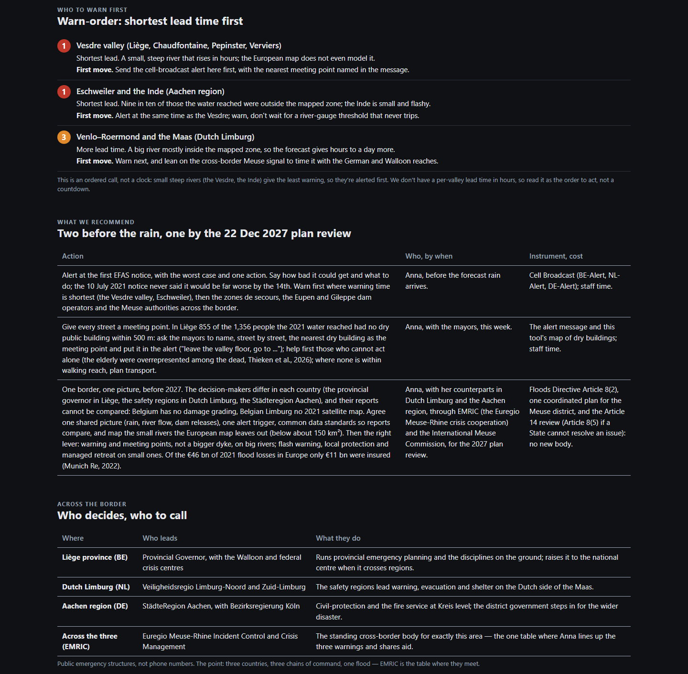

# Flood to policy

[](https://github.com/Siegried81/flood-to-policy/actions/workflows/ci.yml)

The July 2021 floods in Belgium, Germany and the Netherlands, read against the European
flood hazard map, and three recommendations for the review of the Floods Directive.
Built for the European AI Challenge 2026 (JRC x FARI); the policy brief is in
[`docs/hackathon/`](docs/hackathon/) and the answer in [`docs/policy_answer.md`](docs/policy_answer.md).

**Live demo (no install):** https://huggingface.co/spaces/flood-to-policy-team/flood-to-policy-team9

[](docs/screenshots/react_anna_decision.png)

The interactive map is Team 9's work ([`team9/`](team9/), [live](https://warn-before-the-water.surge.sh/team9/));
a [3D view of the Meuse at Liège](https://warn-before-the-water.surge.sh/vesdre_3d.html) is built by `scripts/build_vesdre_3d.py`.

## Key figures

| | |
|---|---|
| **91 %** | of the 1,213 residents the July 2021 water reached in Eschweiler lived outside the European 1-in-100-year flood zone (Ahr valley: 51 %). |
| **25.7 million** | EU-27 residents live in the undefended 1-in-100-year river flood zone. |
| **22 Dec 2027** | review deadline for the flood risk management plans (Directive 2007/60/EC, Art. 14(3)). |

> **A screening view, not the statutory map.** Figures are NUTS3 statistics over the JRC
> river hazard maps, to decide where to look first. The maps that bind are the Member
> States' own (Article 6; EEA Flood Risk Areas Viewer). Say which of the two a figure is.

## Quick start

With Docker (the image holds the code, the built React UI and four small data files):

```bash
docker compose up --build                  # Streamlit on http://localhost:8501
docker compose --profile api up --build    # + React UI and JSON API on http://localhost:8001
```

From source (Linux/WSL2; on the Windows venv read `.venv\Scripts\python.exe`):

```bash
python3 -m venv .venv && .venv/bin/pip install -r requirements.txt
.venv/bin/streamlit run app/streamlit_app.py            # no build step
.venv/bin/uvicorn api.main:app --port 8001              # API
cd web && npm ci && npm run dev                         # React UI on http://localhost:5190
```

Rebuilding the tables needs the raw data (`python -m src.fetch`, about 7 GiB; steps in
[`docs/technical_deep_dive.md`](docs/technical_deep_dive.md)). `python scripts/check_offline_readiness.py`
exits 1 if the demo would need the network.

## Configuration

Copy `.env.example` to `.env` (never committed).

| Setting | Purpose |
|---|---|
| `ANTHROPIC_API_KEY`, `GROQ_API_KEY`, `OLLAMA_URL` | language model for Draft, Translation and Ask; none set means those features are unavailable |
| `FLOOD_APPROVE_TOKEN` | secret `POST /api/approve` requires as `X-Approve-Token`; unset, only local callers may approve |
| `HOSTED=1` | public-demo mode: every model or write route answers 403 |

Ports: Streamlit 8501, API and built React UI 8001, Vite dev server 5190.

## Structure

| Path | Holds |
|---|---|
| `config/`, `src/`, `scripts/` | source registry (`sources.yaml`), the analysis, the builders and fetchers |
| `api/`, `app/`, `web/` | JSON API and MCP tools; Streamlit app; React + Vite UI (`npm run build` copies `data/processed/event_2021_web.json` into `public/`) |
| `team9/` | Team 9's map tool (its `flood_map.html` is kept in Git LFS, see its README) |
| `bi/`, `k8s/` | Power BI project; Kubernetes port of `docker-compose.yml` |
| `docs/`, `tests/` | written work; offline pytest suite |

## Tests and CI

```bash
pip install -r requirements-test.txt      # runtime + pytest
python -m pytest -q                       # tests/ and team9/tests, offline
cd web && npm ci && npm run build         # front end
```

CI runs the suite on Python 3.12 (as the Docker image; the local Windows venv is cp314),
builds `web/` and the image. `requirements-dev.txt` adds local tools (cdsapi, debugpy, playwright).

## Docs

[`policy_answer.md`](docs/policy_answer.md) (findings, recommendations), [`technical_deep_dive.md`](docs/technical_deep_dive.md),
[`datasets.md`](docs/datasets.md), [`limitations.md`](docs/limitations.md), [`responsible_ai.md`](docs/responsible_ai.md),
[`workflow.md`](docs/workflow.md), [`power_bi.md`](docs/power_bi.md),
[`decisions.md`](docs/decisions.md) (dated record of what each figure means).

## Licence and data credits

Code: MIT ([`LICENSE`](LICENSE)). The data keeps its sources' licences, with the exact
credits in [`data/processed/DATA_NOTICE.md`](data/processed/DATA_NOTICE.md): © EuroGeographics
for the administrative boundaries (Eurostat/GISCO, NUTS 2024, non-commercial use); flood
hazard and population/built-up © European Union, JRC (CC BY 4.0); observed flood
© European Union, Copernicus Emergency Management Service (EMSR517, EMSR518, EMSR520);
Natura 2000 and river basin districts © European Environment Agency (CC BY 4.0);
contains modified Copernicus Climate Change Service information 2026; country borders
Natural Earth (public domain); indicators: Source: Eurostat. Region polygons are not
committed: the GISCO terms do not allow it.
