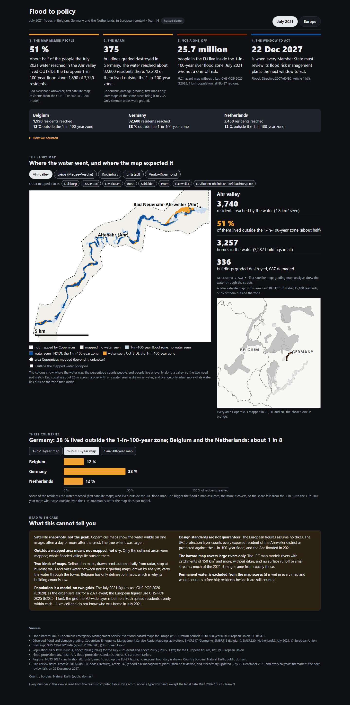
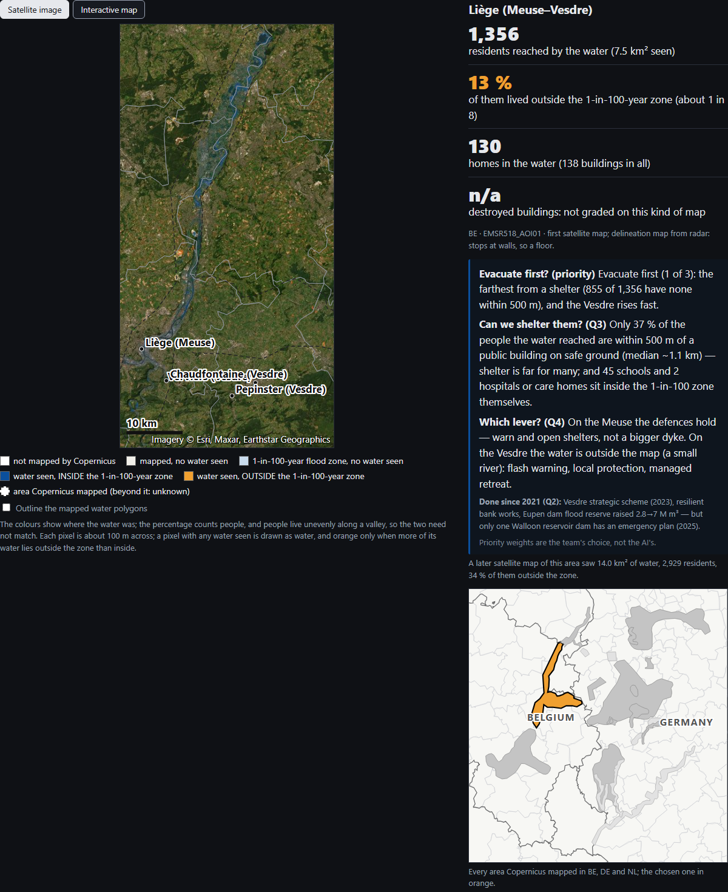
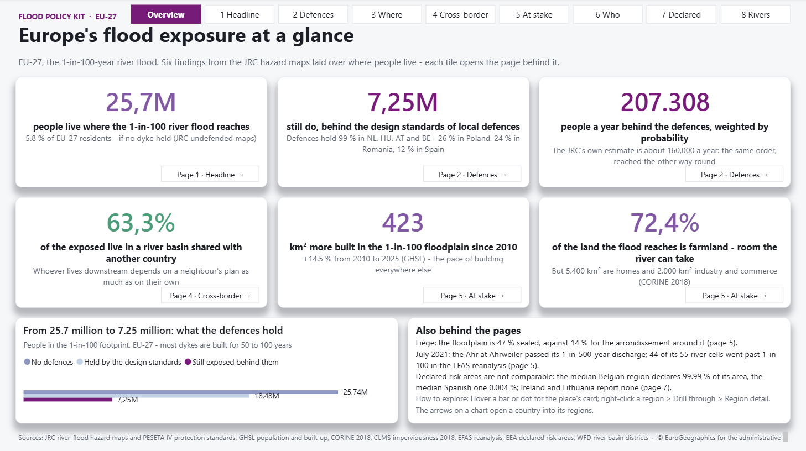

# Flood to policy

From flood maps to a policy recommendation: the July 2021 floods in Belgium,
Germany and the Netherlands, read against the European flood hazard map, and
what the next round of the Floods Directive should change. Built for the
**European AI Challenge 2026 — From Data to Policy** (JRC × FARI, Brussels,
29–30 October 2026).

**Live demo (July 2021 and Europe views, no install):**
https://huggingface.co/spaces/flood-to-policy-team/flood-to-policy

| The July 2021 view | The Vesdre, house by house | Power BI, EU-27 |
|---|---|---|
| [](docs/screenshots/react_july2021.png) | [](docs/screenshots/react_story_liege_meuse_vesdre.png) | [](docs/screenshots/power_bi_00_overview.png) |

Every place's story map and every Power BI page are in
[`docs/screenshots/`](docs/screenshots/) (pages described in
[`docs/power_bi.md`](docs/power_bi.md)); `scripts/screenshots/take_screenshots.ps1`
re-takes the web ones. Credits: observed flood © European Union, Copernicus
Emergency Management Service (EMSR517, EMSR518, EMSR520); flood hazard, population
and buildings © European Union, JRC, CC BY 4.0; country borders Natural Earth
(public domain); regions © EuroGeographics for the administrative boundaries.

| | What the data says |
|---|---|
| **51 %** | of the 3,740 residents the July 2021 water reached in the Ahr valley lived *outside* the European 1-in-100-year flood zone (Copernicus EMS first map, GHS-POP 2020). |
| **375** | buildings graded destroyed in Germany on the first maps (792 with the later maps of the same areas); the water reached about 32,600 residents there, 12,200 of them outside the 1-in-100-year zone. |
| **25.7 million** | EU-27 residents live inside the undefended 1-in-100-year river flood zone: July 2021 was not a one-off risk. |
| **22 Dec 2027** | the deadline for every Member State to review its flood risk management plans (Directive 2007/60/EC, Art. 14(3)): the next window to act. |

The organisers ask for three deliverables (Annex 4): a **policy tool** (any
file: html, pptx, png), the **policy brief** in the Annex 6 template and the
**AI sheet** in the Annex 7 template, e-mailed by 13:30 on Day 2 and followed by
a **five-minute live demo**. The jury weighs four criteria equally: evidence and
soundness, policy usefulness (a named actor), clarity (tool and brief tell one
story) and responsible AI use. This repository is the evidence behind all three.

> **Scope is a funnel: July 2021 at the core, Europe as the context.** The
> challenge data and its data questions (Q1, Q3) are about the July 2021 floods
> in Belgium, Germany and the Netherlands, so that event is the core of the
> brief. The kit's EU-wide work answers the question that follows, *is this a
> one-off?*, and gives the recommendation its scale and its named actor: 25.7
> million EU-27 residents in the undefended 1-in-100 footprint, risk-area
> declarations that cannot be compared between Member States, and the climate
> projections. Its working unit is **NUTS3**: the GISCO NUTS 2024 file holds
> **1,345** NUTS3 polygons, of which **1,165** are in the EU-27 and the rest in
> EFTA and the candidate countries. The model is checked against *observed*
> flood extent on all 27 Copernicus EMS products of July 2021 (4 in Belgium, 22
> in Germany, 1 in the Netherlands; `data/processed/event_2021_products.parquet`).
> See [`docs/scope.md`](docs/scope.md).

> **Expect to be asked whether "European" means the EU-27 or the continent.**
> The ranking returns Turkish regions (Antalya, Sakarya) alongside Dutch, Italian,
> French and German ones, because the GISCO file covers Europe rather than the
> Union. That is defensible — the challenge says European — but it has to be
> stated rather than discovered by a juror. The answer: **1,345 polygons in the
> file, of which 1,165 are in the EU-27, 46 in EFTA (CH, NO, IS, LI) and 134 in
> the candidate and potential-candidate countries (TR, RS, AL, MK, ME, XK).**
> Filter to `EU_STAT == "T"` for an EU-only figure, and say which of the two any
> headline number is.
>
> Beware the related trap: **1,166**, the figure usually quoted for "the number
> of NUTS3 regions", is the EU count for the **NUTS 2021** classification. On the
> NUTS 2024 vintage pinned here it is 1,165, because `DEG0P` (Eisenach) was
> absorbed into the Wartburgkreis. A denominator quoted without its vintage is
> wrong by one region and by three countries' worth of scope.

> **A screening view, never the statutory map.** Every figure in this kit is a
> NUTS3 zonal statistic over the JRC river flood hazard maps, built to decide
> where to look first. The flood hazard and flood risk maps that bind under
> Directive 2007/60/EC are the Member States' own, prepared under Article 6,
> reported to the Commission under Article 15 and served by the EEA Flood Risk
> Areas Viewer (https://discomap.eea.europa.eu/floodsviewer/) and
> WISE-Freshwater. Quote those for a statutory hazard or risk statement about
> any place; quote this kit only for a cross-regional comparison, and say which
> of the two a figure is.

## Why this exists

The challenge is **not** a coding contest: it rewards **three clear, costed,
actionable recommendations** for a public decision-maker, not the most
sophisticated model. The gap in most teams is the middle (political-science
students cannot process a raster, computer-science students cannot write for a
decision-maker), and this repo is built for whoever bridges the two.

## The one equation everything hangs on

```
Risk = Hazard × Exposure × Vulnerability
```

- **Hazard** — where the water goes, and how deep, for a given return period.
  (JRC river flood hazard maps.)
- **Exposure** — who and what is in that water. (GHS-POP population grid,
  OpenStreetMap critical infrastructure.)
- **Vulnerability** — who suffers most from the same water. (Age, income,
  building type, insurance coverage.)

A result that stops at exposure answers "how many people got wet". A result that
reaches vulnerability answers "who needs help first", which is the question a
decision-maker actually has.

## Layout

```
flood-to-policy/
├── config/sources.yaml         # every dataset + document, with provenance
├── config/legislation.yaml     # every legal instrument cited: CELEX, ELI URL, dates, articles relied on
├── src/
│   ├── data_io.py              # loading + CRS harmonisation, one entry point
│   ├── exposure.py             # hazard × population, per admin unit
│   ├── vulnerability.py        # composite index + sensitivity analysis
│   ├── validate.py             # modelled hazard vs observed 2021 extent: hit rate, FAR, IoU
│   ├── rdh.py                  # JRC Risk Data Hub client, responses cached to disk
│   ├── losses.py               # RDH loss rows → a levelled, joinable table
│   ├── events.py               # blind-spot probe over reported coverage (not evidence)
│   ├── assets.py               # built-up surface exposed: the asset half of exposure
│   ├── environment.py          # Natura 2000 area on flood-prone ground (context, not exposure)
│   ├── climate.py              # future flood hazard per region, from the CDS projections
│   ├── basins.py               # river basin districts: exposed in a basin you do not control
│   ├── apsfr.py                # what the Member State declared at risk, vs what the model shows
│   ├── demographics.py         # Eurostat indicators at NUTS3: the axes the index weighs
│   ├── facilities.py           # hospitals and schools inside the flood footprint (GISCO)
│   ├── landcover.py            # CORINE 2018 land cover inside the RP100 zone
│   ├── sealing.py              # sealed soil per region: the runoff side the river maps leave out
│   ├── hera.py                 # observed trend in annual peak discharge (HERA v2)
│   ├── pluvial.py              # projected heavy rain and discharge by warming level (C3S ECDE)
│   ├── efas.py                 # July 2021 as a return period: EFAS reanalysis peak vs EFAS levels
│   ├── rainfall.py             # July 2021 event rainfall per NUTS3 region (EMO-1)
│   ├── event2021.py            # July 2021, product by product: water, people and buildings per EMS map
│   ├── policy_tool.py          # the challenge policy tool: one static, offline HTML page for July 2021
│   ├── story_maps.py           # pure helpers behind the July 2021 story maps, shared by every renderer
│   ├── activations.py          # CEMS rapid-mapping flood activations by country and year
│   ├── toon_io.py              # compact table encoding for LLM prompts
│   ├── legislation.py          # config/legislation.yaml -> citations with article and EUR-Lex URL
│   ├── svgmap.py               # offline choropleth as inline SVG (no tile server)
│   ├── translate.py            # translate an approved brief section, and check its figures survived
│   ├── usage_log.py            # read/write the local AI log, the running note behind the Annex 7 AI sheet
│   ├── fetch.py                # parallel, polite, idempotent collection
│   ├── workflow.py             # LangGraph brief pipeline with an approval gate
│   ├── rag.py                  # grounded "cite or refuse" over the policy corpus
│   └── nlquery.py              # plain-words questions -> a whitelisted query spec, run by pandas
├── scripts/
│   ├── build_exposure.py            # freezes data/processed/exposure.parquet, one row per NUTS3 x RP
│   ├── build_context.py             # freezes data/processed/context.parquet, what qualifies an exposure figure
│   ├── fetch_cds_member.py          # CDS ensemble members, each verified against what was asked
│   ├── fetch_hera.py                # the 30 HERA v2 discharge files (~69.5 GiB), resumable, one at a time
│   ├── fetch_efas_july2021.py       # EFAS reanalysis for July 2021 over the Meuse/Vesdre/Ahr box
│   ├── fetch_c3s_ecde.py            # C3S ECDE heavy-precipitation and flood-recurrence indicators
│   ├── cems_activations.py          # CEMS flood activations by country and year, cached
│   ├── rainfall_jul2021.py          # freezes data/processed/rainfall_jul2021.parquet (EMO-1, 581 regions)
│   ├── build_geometry.py            # freezes data/processed/regions.geojson, the choropleth's polygons
│   ├── validate_2021.py             # JRC RP10/100/500 and Walloon aléa vs four July 2021 truths, Wallonia window
│   ├── groundsource_2021.py         # news-reported July 2021 floods (Groundsource) against the JRC 1-in-100 map, corroboration only
│   ├── event_2021.py                # water, residents and buildings for every July 2021 EMS product -> event_2021_*.parquet
│   ├── event_2021_infrastructure.py # roads, railways and essential services in the July 2021 water, per EMS product
│   ├── build_policy_tool.py         # the policy tool: one offline HTML file + PNG snapshots, in gitignored docs/perso/policy_tool/
│   ├── export_event_web.py          # the July 2021 story as one compact JSON for the React app (public build by default)
│   ├── export_europe_web.py         # freezes the Europe view's API answers into web/public/europe/ for a static build
│   ├── export_bi.py                 # the frozen tables as CSV (+ TopoJSON) for the Power BI project in bi/
│   ├── build_bi_report.py           # writes the Power BI report (PBIR): cover, eight story pages, theme, two drillthroughs, tooltip
│   ├── validate_bi_report.py        # checks every bi/ JSON file against Microsoft's vendored schemas
│   ├── docs_numbers.py              # measures the figures the docs quote and rewrites every marked copy
│   └── check_offline_readiness.py   # is this laptop demo-ready with the Wi-Fi off?
├── api/main.py                 # JSON API over src/, for the React UI
├── api/mcp_server.py           # 3 intent-based MCP tools for agents, answered in flat TOON
├── web/                        # React + Vite UI: choropleth, sensitivity, approval gate
├── app/streamlit_app.py        # seven tabs, no build step: the React five, ask-the-table, the AI log
├── Dockerfile                  # Linux image: the portability answer, not a requirement here
├── docker-compose.yml          # Streamlit / API / tests / offline check / portable demo
├── docs/                       # read these before the event
└── tests/                      # pytest, offline, no network
```

Two of those earn a word here rather than being found by accident.
`src/validate.py` is the credibility half: it scores the modelled hazard layer
against the observed July 2021 extent and returns a hit rate, a false alarm ratio
and an IoU, every one of them `None` rather than `0.0` when its denominator is
empty. `scripts/check_offline_readiness.py` answers the question `pytest` cannot
— the suite mocks the network away, which is exactly what hides a missing 300 MB
raster — and answers it in byte counts, exiting 1 when the demo would still need
a connection.

`Dockerfile` and `docker-compose.yml` exist because `rasterio`, `pyogrio`,
`rasterstats` and `tiktoken` could not load their native libraries on this
Windows host; the `pyogrio`/`pyproj` caps in `requirements.txt` bought back three
of them. Windows Smart App Control then refused `rasterio`'s own GDAL build, which
no pin fixed, on some days and not others with nothing reinstalled (the details
are in `requirements.txt`). **The policy moves both ways, so measure rather than believe
either state.** Measured 2026-10-23, the Windows venv collects the whole suite, as
the WSL2 venv does:
**<!-- numbers:tests_collected -->1,119<!-- /numbers --> collected, nothing deselected, all passing**. The WSL2 venv stays: it is the
only route that does not depend on the policy, and it is where a continental
raster build belongs.

**The `app` image builds and runs:** all four libraries import inside it.
`docker compose --profile tools run --rm test` on a fresh build, last measured on
a smaller suite than today's, gave 703 passed, 0 failed, without `data/` or
`.env`; the image carries `docs/`, `README.md` and `pytest.ini`, which four tests
and the AI log tab read. A stale local image can fail to import `rasterio`
(`libexpat.so.1` missing) where a fresh build of the same Dockerfile succeeds, so
rebuild rather than trust an old local image: `docker compose build`. The `portable` image has not
been built yet.

**VS Code dev container.** `.devcontainer/` opens the editor inside that image
(`Ctrl+Shift+P` → *Dev Containers: Reopen in Container*): a `dev` service with
the checkout mounted at `/workspaces/flood-to-policy`, `data/` included, so
tests and raster work run on Linux without the WSL venv. It leaves `app` and
`api` untouched and runs nothing until you do; Streamlit and the API started
from its terminal are forwarded on 8501 and 8010.

**Prebuilt image.** `.github/workflows/publish.yml` builds the code-only `app`
stage on every push to `main` (and on `v*` tags), starts it and waits for the
Streamlit health check, then pushes it to GitHub Container Registry and, when
the `DOCKERHUB_*` secrets are set, to Docker Hub (page text: `DOCKERHUB.md`).
No build needed to run it:

```bash
docker pull ghcr.io/siegried81/flood-to-policy:latest     # or siegried/flood-to-policy on Docker Hub
docker run --rm -p 8501:8501 -v "$PWD/data:/app/data" ghcr.io/siegried81/flood-to-policy:latest
```

Add `--env-file .env` for an LLM key. The `portable` image (data baked in) is
never published; build it locally.

## Docs, in reading order

[`docs/README.md`](docs/README.md) is the index: the twenty-minute read, one
sentence per file with its measured size, and the full reading order. Read
[`docs/strategy.md`](docs/strategy.md) and [`docs/scope.md`](docs/scope.md)
first; [`docs/policy_answer.md`](docs/policy_answer.md) is the spine (the
question as the organisers ask it, the four findings with their measured
figures, the three recommendations with the article, authority and date behind
each); [`docs/decisions.md`](docs/decisions.md) is the dated record of every
change to what a number means, to read before quoting a figure from an older run.

## Quick start

Written for Linux/WSL2 (`.venv/bin/`). On the Windows venv, read
`.venv\Scripts\python.exe` for `.venv/bin/python`, and `.venv\Scripts\streamlit.exe`
and `.venv\Scripts\uvicorn.exe` for the two UIs; the ambient `python` has
neither pytest nor rasterio.

```bash
python3 -m venv .venv && .venv/bin/pip install -r requirements.txt
.venv/bin/python -m pytest -q           # <!-- numbers:tests_collected -->1,119<!-- /numbers --> tests, offline: no network, no model
                                        # Windows: re-measure, Smart App Control may block
                                        # rasterio (see above). WSL2: wsl -d Ubuntu, then
                                        #   ~/venvs/flood-policy-kit/bin/python -m pytest -q
.venv/bin/python -m src.fetch           # 57 geodata downloads + 25 policy_corpus + 3 context
                                        # = 85 files (done 25 Oct; re-run only to fill gaps)
.venv/bin/python scripts/build_exposure.py --stripes 72 # -> data/processed/exposure.parquet
.venv/bin/python scripts/build_context.py  --stripes 72 # -> data/processed/context.parquet
.venv/bin/python scripts/build_geometry.py             # -> data/processed/regions.geojson
.venv/bin/python scripts/export_bi.py                  # -> bi/data/, read by bi/FloodToPolicy.pbip (docs/power_bi.md)
.venv/bin/python scripts/check_offline_readiness.py   # exits 1 if the demo needs the network
.venv/bin/python scripts/check_offline_readiness.py --strict  # evening before: a WARN blocks too
.venv/bin/python scripts/docs_numbers.py --check      # exits 1 if a doc's number no longer matches the code

# July 2021: event_2021.py first; every step below it reads its tables.
.venv/bin/python scripts/event_2021.py                # reads the organisers' public bucket (cached in data/raw/challenge_2021/) -> data/processed/event_2021_*.parquet
.venv/bin/python scripts/event_2021_infrastructure.py # -> data/processed/event_2021_infrastructure.parquet (July 2021 roads, networks, services)
.venv/bin/python scripts/build_policy_tool.py         # -> docs/perso/policy_tool/policy_tool.html + PNGs (gitignored: GISCO geometry)
.venv/bin/python scripts/export_event_web.py          # -> data/processed/event_2021_web.json + web/public/ copy (July 2021 view, public: Natural Earth borders)
.venv/bin/python scripts/export_event_web.py --full   # -> event_2021_web.full.json, local only (GISCO borders + NUTS3), served by GET /api/event2021 when present

# Either UI. Both read the same frozen table, so they cannot disagree on a number.
.venv/bin/streamlit run app/streamlit_app.py            # no build step
.venv/bin/uvicorn api.main:app --port 8010              # + the React dev server, below
cd web && npm ci && npm run dev                         # npm ci once per fresh clone (node_modules is gitignored); open http://localhost:5190
```

The React app reads the public `web/public/event_2021_web.json` first and calls
`/api/event2021` only when that file is missing, so the local React UI shows the
public build even when `--full` has been run; the `--full` file is what
`GET /api/event2021` answers.

`POST /api/approve` requires the `X-Approve-Token` header when `FLOOD_APPROVE_TOKEN` is set. Unset, it relies on the API being published on 127.0.0.1 only (`docker-compose.yml`).

`HOSTED=1` turns the API into a public demo: `/api/draft`, `/api/translate`, free-text `/api/ask` and `/api/approve` answer 403 before any model is called, and the React UI greys them (it reads `GET /api/config`). The July 2021 view, the React app's first page, reads `event_2021_web.json` and needs no raw data.

The React UI is the one to demo: it draws the choropleth as **SVG from GeoJSON**,
with no tile provider and no API key, so the map still works with the network
unplugged. Streamlit is the fallback that needs no `npm`.

Ubuntu and WSL ship no `python` on `PATH`, only `python3`. Calling `.venv/bin/...`
directly instead of activating the venv keeps that distinction out of the way and
removes the one failure mode of a hackathon morning: running against system Python
because the activation was forgotten.

**`--stripes` is memory, not meaning:** the windows are disjoint, so the figures do
not depend on it, and `tests/test_stripes.py` holds that. The default of 10 was
enough on a workstation and is not enough inside a 16 GB WSL VM: a nine-period
run at 24 was killed by the OOM killer on the 100-year period, which floods more
cells than the frequent ones. 72 peaks around 7.5 GB. The exposure build **parks
each return period** in `data/processed/exposure_parts/` as it finishes and reuses
what is already there, so an interrupted run costs one period rather than all of
them; `--return-period` narrows what is computed without ever shrinking the frozen
table, and `--rebuild` recomputes a parked period.

### Data to fetch before the event

The raw downloads are **not** committed (`data/` is ignored), except four files in
`data/processed/`: `exposure.parquet`, `context.parquet`, `event_2021_web.json`
and `DATA_NOTICE.md`. `.venv/bin/python -m src.fetch` downloads what
`config/sources.yaml` declares, **85 files** (counted 27 Oct; ≈6.96 GiB measured on
25 Oct, when it was 84); the breakdown by section and why the printed count is
files, not sources, is in
[`docs/datasets.md`](docs/datasets.md#what-the-whole-download-costs). It ran on
25 October; never start it at the venue: the Wi-Fi of a 60-person hackathon will
not move gigabytes of raster. The run is idempotent, so an interrupted download costs only
the files still missing.

Of the sources outside `src.fetch`, three need preparing before the event, each
for its own reason (HERA, the EFAS July 2021 reanalysis and the C3S ECDE
indicators have their own fetch scripts, listed under Layout):

- **JRC Risk Data Hub** wants an EU Login bearer token that expires after 10
  hours: the account is created now, the responses are cached the day before,
  and the token is refreshed on the morning of the event.
- **EEA river basin districts** is a REST service that takes about five minutes
  over 8 pages and answers HTTP 500 to a page it dislikes. `src/basins.py`
  caches it to `data/processed/basins_cache/` (288 MiB); fetch it once before
  the event.
- **Copernicus CDS hydrology projections** are fetched by
  `scripts/fetch_cds_member.py` (one member per request, under the form's 1000
  cap, `--all-missing` for the rest of the ensemble; `CDSAPI_KEY` or
  `~/.cdsapirc`), or by hand through the CDS form. Either way the `.nc` files
  land in `data/raw/download/cds_hydrology_projections/`.

`scripts/check_offline_readiness.py` skips `access: api` and `folder` entries, so
none of the three appears in its per-file table, but each has a check of its own:
the RDH cache is a **FAIL** when empty (it is the only offline route to a loss
figure), the basins cache and the CDS folder are **WARN** when absent (the map
and the brief run without them; the shared-basin and climate layers simply say
so). The verdict has three states (`READY`, `READY WITH CAVEATS`, `BLOCKED`), and
`--strict`, the mode to run the evening before, turns every caveat into a block:
an `ANTHROPIC_API_KEY` or `GROQ_API_KEY` left in `.env` is a caveat on any other
day and the thing that routes the demo through the venue Wi-Fi on that one. At
the event a personal key is not allowed at all (Annex 3): remove it, and use the
team key or local Ollama.

### Live demo

A static build needs no API at all. It shows the July 2021 view and the Europe
view (Exposure with the return-period selector, Context and Vulnerability) from
the API's own answers, frozen into `web/public/europe/` by
`scripts/export_europe_web.py`. The public demo is that build, served as a
static Hugging Face Space:
https://huggingface.co/spaces/flood-to-policy-team/flood-to-policy

```bash
.venv/bin/python scripts/export_event_web.py           # only after a new event_2021.py run: the committed JSON is already the public build
.venv/bin/python scripts/export_europe_web.py          # Europe view: frozen API answers -> web/public/europe/ (gitignored, ~19 MB)
cd web && npm ci                                        # once per fresh clone: node_modules is gitignored, so there is no vite yet
VITE_STATIC=1 VITE_BASE=/ npm run build                 # in web/ -> web/dist/
```

In Git Bash prefix the build with `MSYS_NO_PATHCONV=1` so the base is not
rewritten into a Windows path; use `VITE_BASE=/flood-to-policy/` for a site
served under a sub-path. To update the Space, upload the contents of
`web/dist/` (`index.html`, `event_2021_web.json` and the `assets/` and `europe/`
folders) under *Files → Add file → Upload files*. In the static build the region
map is drawn from GISCO's 1:20 million NUTS file, which the viewer's browser
fetches from GISCO itself, so no GISCO geometry is published here; the
vulnerability ranking is precomputed at ±30 % and top 10 for every indicator
set. Draft and Translation call a language model and stay local.

### Agent access (MCP)

`api/mcp_server.py` exposes the kit to an AI agent (Claude Desktop, Claude Code,
any MCP client) as **three tools shaped around a question, not around a route**.
The no-personal-key rule above holds here too; Claude Code burns the team's
tokens fastest, so use it sparingly during the event
([`docs/responsible_ai.md`](docs/responsible_ai.md)).

| Tool | The question it answers |
|---|---|
| `rank_regions(top_n, return_period, country)` | where should we look first? |
| `profile_regions(region_ids)` | tell me about / compare these regions |
| `find_policy_evidence(question, k)` | what does the corpus say about X? (cite or refuse) |

Each does its chaining server-side and answers with a small **flattened TOON**
table, so the agent makes one call instead of chaining `/exposure`, `/context`
and `/search` over raw JSON. `/approve` is deliberately not a tool: a human signs
the brief. The return period travels in a `# return_period=...` header with every
figure.

```bash
.venv/bin/python -m api.mcp_server                      # stdio, what desktop clients launch
claude mcp add flood-kit -- .venv/bin/python -m api.mcp_server   # register in Claude Code
.venv/bin/python -m api.mcp_server streamable-http      # over HTTP (e.g. a Render web service)
docker compose --profile agent run --rm -T mcp          # same, inside the container
```

### Asking the table in plain words

The Streamlit tab **Ask the table** and `POST /api/ask` let someone who does not
write pandas interrogate `exposure.parquet`. The model writes a small JSON query
spec and nothing else; `src/nlquery.py` refuses any column or operator outside
its whitelist and pandas runs the rest, so every figure in an answer is a value
of the frozen table. Each answer names its return period and carries the
definition and unit of every column it used.

```bash
curl -s localhost:8010/api/ask -H 'Content-Type: application/json' \
  -d '{"question": "Which five Belgian regions have the largest share exposed at RP100?"}'
# No key and no local model? Send the spec itself; no model is called.
curl -s localhost:8010/api/ask -H 'Content-Type: application/json' -d '{"spec": {
  "columns": ["region", "exposed_share"], "return_period": 100, "limit": 5,
  "filters": [{"column": "country", "op": "==", "value": "BE"}],
  "sort": {"column": "exposed_share", "descending": true}}}'
```

## Licence and data credits

The code is MIT ([`LICENSE`](LICENSE)). The data is not: the files committed
under `data/processed/` (the two frozen tables `exposure.parquet` and
`context.parquet`, and the public July 2021 view `event_2021_web.json`) keep
their sources' licences, listed with the exact credit each requires in
[`data/processed/DATA_NOTICE.md`](data/processed/DATA_NOTICE.md). In short:
© EuroGeographics for the administrative boundaries (Eurostat/GISCO, NUTS 2024,
non-commercial use); flood hazard and population/built-up © European Union, JRC
(CC BY 4.0); Natura 2000 and river basin districts © European Environment Agency
(CC BY 4.0); contains modified Copernicus Climate Change Service information 2026;
indicators: Source: Eurostat. The region polygons themselves are not committed,
because the GISCO terms do not let this repository pass them on.
